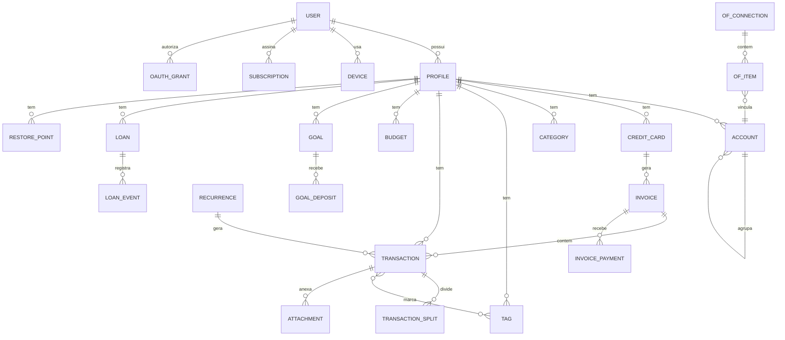

# 05 — Modelo de dados

Modelo lógico proposto [I], derivado das regras do doc 02. Notação: `campo: tipo` (`?` = opcional). Todas as entidades sincronizáveis têm os **campos comuns**:

```
id: uuid (v7, gerado no cliente)
profile_id: uuid          -- exceto entidades de nível usuário
created_at, updated_at: timestamptz
deleted_at?: timestamptz  -- tombstone para sync
server_version: bigint    -- versão monotônica por usuário
hlc: text                 -- relógio lógico híbrido para merge por campo
```

Valores monetários: `bigint` em centavos (moeda do perfil). Datas de negócio: `date`.

## Diagrama (resumo)



## 1. Nível usuário

### user
```
id, email (unique), email_verified_at?, name, birth_date?, password_hash?
locale, timezone (default 'America/Sao_Paulo')
marketing_opt_in: bool
last_active_at: timestamptz          -- RN-USR-06
trial_started_at?, trial_ends_at?    -- RN-PLN-02
deletion_scheduled_at?
wrapped_dek: bytea                   -- DEK do usuário cifrada pela KEK no KMS (SEC-CR-03/04)
totp_secret_enc?, recovery_codes_hash[]?  -- 2FA (SEC-ID-02)
```

### device
```
id, user_id, platform (android|ios|web|kids), display_mode? (browser|standalone)  -- web: aba ou PWA instalado (RN-DEV-06)
os_name?, browser_name?, model, app_version
install_id (persistente), push_token?
last_seen_at, revoked_at?
```
### device_disconnect_log
`user_id, device_id, at` — conta as desconexões do mês no Essencial (RN-DEV-02).

### subscription
```
id, user_id, plan (essencial|plus|conecta|pro)
period (monthly|annual), status (trialing|active|grace|canceled|expired|refunded)
store (web|google_play|app_store), store_ref
started_at, current_period_end, cancel_at_period_end: bool
refundable_until (started_at + 7d)    -- RN-PLN-05
```
### entitlement (view materializada)
`user_id, plan_effective, of_institution_limit, ai_credits_month, mcp_reads_day, mcp_reads_month, mcp_writes_day, restore_points_max, attachments_quota_bytes, multi_device: bool, web_access: bool`

### ai_credit_ledger
`user_id, month (YYYY-MM), delta, reason (grant|chat|report|ocr|...), ref_id?, at` — o saldo é a soma do mês e não acumula (RN-ZOE-03).

### profile
```
id, user_id, name, currency (ISO 4217), color, icon
pin_hash?, pin_failed_attempts, pin_locked_until?     -- RN-PRF-07
archived_at?, archived_reason? (manual|downgrade)
purchased_standalone: bool                            -- RN-PRF-05
sort_order
settings: jsonb   -- dashboard cards, saldo config, extrato prefs, modo privado, dia início mês
```

## 2. Cadastros do perfil

### account
```
name, kind (checking|savings|cash|wallet|investment|credit_line|other)
account_category_id?    -- agrupamento visual "categoria de contas"
initial_balance: bigint, initial_balance_date: date
overdraft_limit?: bigint
is_default: bool, ignore_in_totals: bool
is_group: bool, parent_group_id?: uuid   -- RN-CTA-05 (1 nível)
is_investment: bool
account_number?, bank_code?, last4_digits?  -- RN-CTA-08/09
image_ref?, color, archived_at?, sort_order
```

### credit_card
```
name, image_ref?, last4_list: text[]                 -- RN-CRT-01
due_day: smallint (1..31)
closing_rule: (days_before_due|fixed_day)
closing_value: smallint                               -- N dias ou dia fixo
credit_limit?: bigint
default_payment_account_id?
wallet_name?                                          -- iOS Carteira
archived_at?
```

### invoice (fatura)
```
credit_card_id, due_date: date (identifica a fatura), closing_date: date
status (open|closed|paid|partially_paid|overdue)      -- RN-CRT-13 (derivável)
carry_over_credit: bigint                             -- RN-CRT-10
reopened_at?
```
Única por `(credit_card_id, due_date)`. É criada de forma preguiçosa ao receber a primeira compra.

### invoice_payment
`invoice_id, account_id, amount, paid_on: date, kind (full|partial|advance), transaction_id` — cada pagamento gera um lançamento de saída na conta (RN-CRT-07/08).

### category
```
type (income|expense), name, parent_id? (2 níveis), icon, color
is_system: bool (Outros)    -- RN-CAT-03
archived_at?, sort_order
```

### tag
`name (unique ci por perfil), color`

## 3. Lançamentos

### transaction
```
type (income|expense|transfer)
description, amount: bigint (pode ser negativo — RN-LAN-18..20)
status (pending|settled)
launch_date: date, due_date: date, settled_date?: date     -- RN-LAN-04..07
account_id?             -- receita/despesa em conta; origem na transferência
dest_account_id?        -- transferência
credit_card_id?, invoice_id?       -- despesa de cartão
category_id?            -- null se multicategoria ou transferência
notes?, place_name?, lat?, lng?
ignore_in_totals: bool
ignore_in_card_limit: bool          -- RN-CRT-04
recurrence_id?, installment_number?, installment_total?
source (manual|open_finance|ofx|csv|notification|sms|wallet|siri|mia|mcp|loan|import_receipt)
external_id?            -- FITID OFX / id transação agregador (unique por conta+source)
of_item_id?
reconciled_with_id?     -- vínculo mescla (RN-IMP-13)
loan_id?, loan_role? (principal_out|principal_in|repayment|interest)  -- RN-EMP
locked_fields: text[]   -- ex.: ['amount','dates','account'] para OF/loan (RN-OF-10, RN-EMP-17)
cross_profile_link_id?  -- RN-PRF-08
created_by_client?      -- oauth client_id quando via MCP
```
Índices: `(profile_id, due_date)`, `(profile_id, settled_date)`, `(profile_id, launch_date)`, `(invoice_id)`, `(account_id, status)`, GIN em `to_tsvector(description||notes)`.

### transaction_split (multicategorias)
`transaction_id, category_id, amount` — Σ amount = transaction.amount (RN-LAN-17).

### transaction_tag
`transaction_id, tag_id`

### attachment
`transaction_id, storage_key, mime, size_bytes, uploaded_at` — a cota é somada por usuário/mês (RN-LAN-29).

### recurrence
```
kind (fixed|installments)
frequency (daily|weekly|biweekly|monthly|bimonthly|quarterly|semiannual|annual)
interval: int, start_date: date, total_count?: int, start_number?: int
template: jsonb      -- campos copiados para cada ocorrência
amount_mode (per_installment|total_split)
materialized_until: date   -- RN-LAN-15
end_date?            -- encerramento manual de fixa
```

## 4. Planejamento

### budget
```
kind (expense|income), name, color, icon
period_type (monthly|custom), start_date, end_date?
target_mode (fixed|pct_total_income|pct_income_budget|group)
target_amount?, target_pct?, target_income_budget_id?
filter_category_ids: uuid[], filter_tag_ids: uuid[], tag_mode (any|all|none)
filter_card_ids: uuid[]
include_ignored: bool, use_forecast: bool
reference_date (due|settled|launch)
alert_pct?, show_on_dashboard: bool, include_in_forecast_balance: bool
group_member_ids: uuid[]        -- se group
archived_from?: date
```
### budget_month_override
`budget_id, month (YYYY-MM), target_amount, applies_forward: bool` — RN-ORC-11.
### budget_transfer
`from_budget_id, to_budget_id, month, amount` — RN-ORC-12.

### goal
```
name, target_amount, target_date, motivation?, color, icon
mode (deposits|linked_account)
initial_amount (apenas deposits), linked_account_id? (conta ou grupo)
achieved_at?, achieved_manual: bool
```
### goal_deposit
`goal_id, amount (±), date, notes?, monthly: bool, recurrence_id?, source_transaction_id?`

### loan
```
direction (lent|borrowed), description, counterparty
principal: bigint, start_date, account_id
already_in_progress: bool, open_balance_at_start?
income_category_id?, expense_category_id?
interest_rate_pct?, interest_period (month|year)?, interest_ref_date?
expected_payoff_date?, archived_at?
```
### loan_event
`loan_id, kind (installment_scheduled|repayment|interest|abatement|abatement_undo|link|unlink), amount, date, transaction_id?, installment_no?`

Saldo em aberto = principal − Σ repayment.principal − Σ abatement + Σ abatement_undo (RN-EMP-11/15).

## 5. Importação e conciliação

### import_template
`name, file_kind (csv|xlsx), fields: text[] (ordem), has_header, separator, date_format, negative_is_expense, default_account_id?, default_card_id?`

### import_batch
`source (ofx|csv|xlsx|notification|...), file_hash, target_account_id?, target_card_id?, created_count, updated_count, skipped_count, at`

### reconciliation_suggestion
`profile_id, imported_tx_id, candidate_tx_id, score, status (open|accepted|rejected), reason jsonb`

### notification_log (somente no dispositivo, não sincroniza — RN-NTF-07)
`app_package, title, body, parsed jsonb, status (imported|ignored|pending|failed), transaction_id?, received_at, expires_at`

## 6. Open Finance

### of_connection
```
user_id, profile_id, aggregator ('pluggy'), aggregator_item_id (criptografado)
institution_id, institution_name, status (updating|ok|login_error|outdated|waiting_user_input|error)
last_sync_at, next_sync_at, consent_expires_at?
categorization_mode (auto_create|existing_only)    -- RN-OF-09
allow_notification_import: bool (default false)    -- RN-NTF-08
```
Conta para o limite do plano: `count(distinct institution_id)` ativas (RN-OF-02).

### of_item
`connection_id, aggregator_account_id, kind (account|card), linked_account_id?|linked_card_id?, link_mode (new|manual_link), linked_at, unlinked_at?`

### of_raw_transaction
`of_item_id, aggregator_tx_id, payload jsonb, received_at, transaction_id?` — trilha de auditoria e base para "reiniciar dados".

### automation_rule [I]
`profile_id, match jsonb (descrição contém, valor ±%, conta), action (settle_partial|match_variable|suggest), target_transaction_id|recurrence_id`

## 7. IA e MCP

### ai_conversation / ai_message
`user_id, profile_id, role, content, tool_calls jsonb, credits_spent, created_at`

### ai_monthly_report
`profile_id, month, content_md, metrics jsonb, generated_at`

### oauth_client
`client_id, name, redirect_uris[], verified: bool, created_via (preregistered|dcr), created_at`

### oauth_grant
`user_id, client_id, scopes[], allow_create_without_confirm: bool, allow_adjust_without_confirm: bool, created_at, last_used_at, revoked_at?`

### oauth_token
`grant_id, kind (access|refresh), hash, expires_at, family_id, revoked_at?`

### mcp_usage_counter
`user_id, window (day|month), window_start, reads, writes` — RN-MCP-08.

### pending_action (rascunho que exige confirmação)
`user_id, profile_id, origin (mia|mcp), client_id?, action_type, payload jsonb, status (pending|confirmed|rejected|expired), expires_at`

## 8. Sincronização e restauração

### change_log
`user_id, server_version (seq), entity, entity_id, op (upsert|delete), fields jsonb, device_id, at` — fonte do delta de sync.

### restore_point
`profile_id, description, notes?, snapshot_storage_key, size_bytes, created_at` — máx. 15 por perfil (RN-SYN-04/05).

## 8A. Segurança e auditoria (doc 10)

### audit_log (append-only, sem UPDATE/DELETE para o papel da aplicação)
`id, user_id?, actor_type (user|device|oauth_client|employee|system), actor_id, action, target_type, target_id, ip_hash, user_agent, device_id?, client_id?, metadata jsonb (sem dados C3/C4), at` — SEC-LOG-02.

### security_event (visível ao usuário)
`user_id, kind (login|new_device|password_changed|2fa_changed|mcp_connected|of_connected|export|...), device_label, approx_location?, at` — SEC-LOG-03.

### remote_wipe
`device_id, requested_at, executed_at?` — SEC-ID-06.

## 9. Zooloo Kids

### kid_profile
`guardian_user_id, nickname, avatar, paired_device_id?, created_at`
### kid_entry
`kid_profile_id, kind (earned|spent), amount, category, date, note?`
### kid_dream
`kid_profile_id, name, target_amount, saved_amount, icon`
### kid_agreement (Combinado)
`kid_profile_id, title, due_date?, reward_amount?, reward_text?, status (pending|done_by_kid|confirmed|expired)`

## 10. Enums e cálculos derivados (referência rápida)

| Derivado | Fórmula |
|---|---|
| Saldo atual da conta | `initial_balance + Σ settled (income − expense ± transfer)` até hoje |
| Saldo previsto (data D) | saldo atual + Σ pending com data efetiva ≤ D (`due_date`) |
| Data efetiva no caixa | `status=settled ? settled_date : due_date` |
| Fatura de compra | ver doc 07 §2.1 (algoritmo de fechamento) |
| Total da fatura | Σ despesas (com sinal) da fatura − carry_over_credit |
| Pendente da fatura | total − Σ invoice_payment |
| Orçamento considerado | Σ transações filtradas no período pela `reference_date` (settled; + pending se use_forecast) |
| Objetivo alcançado | deposits: `initial_amount + Σ deposits`; linked: saldo atual da conta ou grupo |
