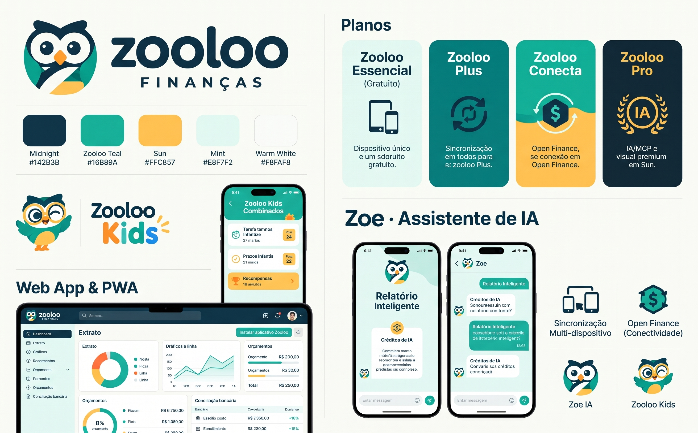

# 13 — Identidade visual



> A imagem acima é a **prancha conceitual** da marca. Os textos dentro das telas de exemplo (cards, gráficos, mensagens da Zoe, nomes de menu) são ilustrativos e contêm erros de digitação; não devem ser usados como texto do produto. Textos oficiais ficam em `@zooloo/i18n`, e regras de plano no [doc 08](08-planos-e-limites.md).

## Conceito da marca
### A direção escolhida é uma marca que combina:
- Confiança: importante para um aplicativo financeiro.
- Modernidade: aparência de fintech profissional.
- Proximidade: comunicação simples e amigável.
- Família: possibilidade de expansão para o Zooloo Kids.
- Marca: Zooloo Finanças
- Símbolo: Coruja estilizada com Z
- Estilo: Minimalista, moderno e amigável

## 1. Logotipo e símbolo

- **Símbolo**: coruja estilizada em círculo, com o corpo formando um **Z** (Midnight sobre Teal, com o detalhe inferior em Sun) e bico em laranja/Sun.
- **Logotipo horizontal**: símbolo + palavra **"zooloo"** em minúsculas, Midnight, sem serifa geométrica e pesada; abaixo, **"FINANÇAS"** em maiúsculas, espaçada, alinhada à largura da palavra.
- **Só o símbolo** é usado em: ícone do app (nome "Zooloo"), ícone do PWA, favicon, avatar da Zoe e espaços pequenos.
- Versões necessárias [I]: colorida em fundo claro, negativa (fundo Midnight), monocromática Midnight e monocromática branca.
- Área de proteção [I]: margem mínima em volta do logotipo igual à altura do "o" de "zooloo". Tamanho mínimo: símbolo com 24 px no digital; logotipo horizontal com 120 px de largura.
- Não fazer: distorcer, rotacionar, trocar as cores, aplicar sombra ou contorno, ou colocar o logotipo colorido sobre fundo Teal ou Sun sem a versão negativa ou monocromática.

## 2. Paleta

### 2.1 Cores da marca

| Token | Nome | Hex | Papel |
|---|---|---|---|
| `color.midnight` | Midnight | `#142B3B` | Texto principal, topbar, fundo do tema escuro, plano Pro |
| `color.teal` | Zooloo Teal | `#16B89A` | Cor principal da marca: símbolo, destaques, gráficos, barras de progresso, ícones ativos |
| `color.sun` | Sun | `#FFC857` | Destaque e calor: avisos, recompensas, detalhes premium, Zooloo Kids |
| `color.mint` | Mint | `#E8F7F2` | Fundos de seção, cards de destaque, item ativo de menu, plano Essencial |
| `color.warm-white` | Warm White | `#F8FAF8` | Fundo da aplicação no tema claro |

### 2.2 Cores derivadas [I]

Necessárias para cumprir contraste (RNF-UX-01, WCAG 2.1 AA):

| Token | Hex | Uso |
|---|---|---|
| `color.teal-700` | `#0B7A66` | Botão primário com texto branco, links e texto em Teal sobre fundo claro |
| `color.surface` | `#FFFFFF` | Cards no tema claro |
| `color.text-muted` | `#5B6B77` | Texto secundário no tema claro |
| `color.midnight-900` | `#0F1F2B` | Fundo de página no tema escuro (cards em `#142B3B`) |
| `color.text-muted-dark` | `#9FB3C1` | Texto secundário no tema escuro |

### 2.3 Regras de contraste

Razões de contraste calculadas (WCAG):

| Combinação | Contraste | Uso permitido |
|---|---|---|
| Midnight sobre Warm White / branco / Mint | 13,9 / 14,6 / 13,2 | Qualquer texto |
| Midnight sobre Sun | 9,5 | Qualquer texto (botões e selos em Sun usam texto Midnight) |
| Midnight sobre Teal | 5,8 | Qualquer texto |
| Branco sobre Teal-700 `#0B7A66` | 5,3 | Qualquer texto (botão primário) |
| Teal sobre Midnight | 5,8 | Qualquer texto (tema escuro) |
| Branco sobre **Teal** `#16B89A` | **2,5** | Só ícones grandes e títulos ≥ 24 px; **nunca** texto de corpo nem botões |
| Teal sobre branco / Warm White | **2,5** | Só elementos gráficos (barras, ícones, bordas), **nunca** texto |
| Sun sobre branco | **1,5** | Só elementos gráficos com contorno ou sobre Midnight |

> A prancha mostra texto branco sobre Teal (botão "Instalar aplicativo Zooloo", card do Zooloo Plus, balões da Zoe). Na implementação, esses elementos usam **Teal-700** (`#0B7A66`) com texto branco, ou Teal com texto Midnight.

### 2.4 Cores semânticas financeiras [I]

A cor da marca **não** representa entrada de dinheiro. Receita e despesa têm cores próprias e sempre vêm com sinal e ícone (RNF-UX-02).

| Token | Tema claro | Tema escuro | Uso |
|---|---|---|---|
| `color.income` | `#15803D` (5,0 sobre branco) | `#4ADE80` (8,4 sobre Midnight) | Receitas, valores positivos |
| `color.expense` | `#B91C1C` (6,5 sobre branco) | `#F87171` (5,3 sobre Midnight) | Despesas, valores negativos, saldo negativo |
| `color.warning` | fundo Sun + texto Midnight | fundo Sun + texto Midnight | Vencimentos próximos, orçamento perto do limite |
| `color.info` | Teal-700 | Teal | Pendências, sincronização |

Gráficos usam a sequência: Teal, Midnight, Sun, laranja `#F47C3C`, Mint com borda, cinza `#9FB3C1`, sempre com legenda textual.

## 3. Tipografia

**Decisão** (18/11/2026): a prancha usa sans-serif geométrica, de formas abertas e peso forte nos títulos. As fontes escolhidas combinam esse tom amigável com a legibilidade de dados de uma fintech:

| Uso | Fonte | Pesos | Motivo |
|---|---|---|---|
| Títulos, marca, números em destaque (saldo, valor do formulário) | **Plus Jakarta Sans** | 600, 700, 800 | Geométrica, moderna e amigável, próxima do logotipo "zooloo"; tem algarismos tabulares |
| Interface, tabelas, extrato, formulários | **Inter** | 400, 500, 600 | Feita para telas, ótima em tamanhos pequenos e em tabelas densas; algarismos tabulares e suporte completo a pt-BR |
| Zooloo Kids (títulos) | **Nunito** | 700, 800 | Arredondada e lúdica, combina com a coruja ilustrada; corpo de texto do Kids segue em Inter |

Regras:

- Todo valor monetário usa `font-variant-numeric: tabular-nums` (Inter e Plus Jakarta Sans têm), para alinhar colunas de extrato, faturas e relatórios.
- Escala: 12 / 14 / 16 (corpo) / 20 / 24 / 32 / 40 px. Valor em destaque no formulário de lançamento e saldo no Resumo: 32–40 px em Plus Jakarta Sans 700.
- Altura de linha: 1,5 no corpo; 1,2 em títulos.
- As três fontes têm licença **SIL OFL** e são servidas pelo próprio app em WOFF2 com *subset* latino (sem CDN de terceiros, por privacidade e CSP). Fallback: `system-ui, -apple-system, "Segoe UI", Roboto, sans-serif`.
- No mobile (Fase 2), as mesmas fontes via `expo-font`.

## 4. Iconografia e ilustração

- **Ícones de interface**: linha, traço de 2 px, cantos arredondados, em Midnight (ativo em Teal-700). Proposta [I]: Lucide, por ser de linha e ter licença aberta.
- **Ícones de plano** (prancha): Essencial = celular e tablet; Plus = setas de sincronização; Conecta = hexágono com cifrão entre setas; Pro = laurel com "IA".
- **Mascote**: a coruja é o personagem da marca. Na Zoe, aparece como avatar; no Zooloo Kids, em versão ilustrada e expressiva.
- Cantos arredondados (raio 12–16 px em cards, 8–10 px em botões e campos), sombras leves e muito espaço em branco.

## 5. Aplicação por produto

### 5.1 Web App e PWA

Seguindo a prancha e o doc 06:

- **Topbar Midnight** com símbolo + "zooloo FINANÇAS" em branco, busca, botão "+" (novo lançamento, tecla `N`), notificações e avatar.
- **Menu lateral** em fundo claro, item ativo em Mint com texto e ícone Midnight/Teal-700.
- **Conteúdo** em Warm White com cards brancos.
- Botão **"Instalar aplicativo Zooloo"** (RF-PWA-03) no cabeçalho da área de conteúdo, em Teal-700 com texto branco.
- **Manifest do PWA**: `theme_color` `#142B3B` (combina com a topbar) e `background_color` `#F8FAF8`; ícones do símbolo em 192, 512 e *maskable* com área de segurança de 80%.

### 5.2 Planos

| Plano | Fundo do card | Texto | Ícone |
|---|---|---|---|
| Zooloo Essencial | Mint | Midnight | Dispositivos |
| Zooloo Plus | Teal-700 | Branco | Sincronização |
| Zooloo Conecta | Teal (topo) para Sun (base) | Midnight | Hexágono com cifrão |
| Zooloo Pro | Midnight | Título em Sun, texto branco | Laurel "IA" |

> A frase do card Pro na prancha ("IA/MCP e visual premium") não segue o doc 08: IA e MCP já existem a partir do Plus, com limites por plano. O texto do card deve vir da matriz do doc 08.

### 5.3 Zoe

- Avatar: símbolo da coruja.
- Balão do usuário em Teal-700 com texto branco; balão da Zoe em branco ou Mint com texto Midnight.
- Saldo de créditos de IA em selo Sun com texto Midnight.

### 5.4 Zooloo Kids

- Coruja ilustrada com óculos em Sun, asas abertas e expressão alegre.
- Logotipo "Zooloo" em Midnight + "Kids" em degradê laranja/Sun com detalhe em Teal.
- Cabeçalhos em Teal, cards de recompensa em Sun, tipografia mais arredondada e tamanhos maiores.
- As mesmas regras de contraste valem; nenhum texto em branco sobre Teal ou Sun.

## 6. Tokens de design

Os valores deste documento são a fonte do pacote `@zooloo/ui-tokens` (doc 09 §3), consumido pelo web-app, pelo site e pelos apps mobile:

```json
{
  "color": {
    "midnight": "#142B3B",
    "midnight-900": "#0F1F2B",
    "teal": "#16B89A",
    "teal-700": "#0B7A66",
    "sun": "#FFC857",
    "mint": "#E8F7F2",
    "warm-white": "#F8FAF8",
    "surface": "#FFFFFF",
    "text-muted": "#5B6B77",
    "text-muted-dark": "#9FB3C1",
    "income": { "light": "#15803D", "dark": "#4ADE80" },
    "expense": { "light": "#B91C1C", "dark": "#F87171" }
  },
  "radius": { "sm": 8, "md": 12, "lg": 16 },
  "font": {
    "display": "Plus Jakarta Sans",
    "ui": "Inter",
    "kids": "Nunito"
  }
}
```

Um teste automatizado verifica o contraste de todos os pares texto/fundo declarados nos tokens (≥ 4,5:1 para texto normal), conforme RNF-QA-05.

## 7. Ativos pendentes

- [ ] Arquivos vetoriais (SVG) do símbolo e do logotipo nas 4 versões (§1), com grade de construção. **Adiado** (18/11/2026): até a entrega, o desenvolvimento usa ativos provisórios (§7.1).
- [ ] Ícones de app: Android adaptativo, iOS, PWA (192, 512, *maskable*), favicon e `apple-touch-icon`.
- [x] Definição e licença da tipografia (§3).
- [ ] Biblioteca no Figma com componentes e telas do MVP (doc 11).
- [ ] Ilustrações da coruja (Zoe e Zooloo Kids) em vetor.
- [ ] Registro da marca e do símbolo no INPI.

### 7.1 Ativos provisórios (até a entrega dos vetores)

- **Logotipo na topbar e no site**: componente `<ZoolooLogo>` em `@zooloo/ui-tokens` que, provisoriamente, renderiza o texto "zooloo" em Plus Jakarta Sans 800 + "FINANÇAS" espaçado, com um círculo Teal no lugar do símbolo.
- **Ícones do PWA e favicon**: círculo Teal com "Z" em Midnight, gerados por script a partir dos tokens (192, 512, *maskable* e favicon).
- **Avatar da Zoe**: o mesmo círculo provisório.
- Todos os usos passam por esse componente e por um único diretório de ícones (`apps/web-app/public/icons/`). Assim, quando os SVGs chegarem, a troca é feita em um só lugar, sem mudar telas.
- Ativos provisórios não vão para o lançamento público (Fase 1.1).
